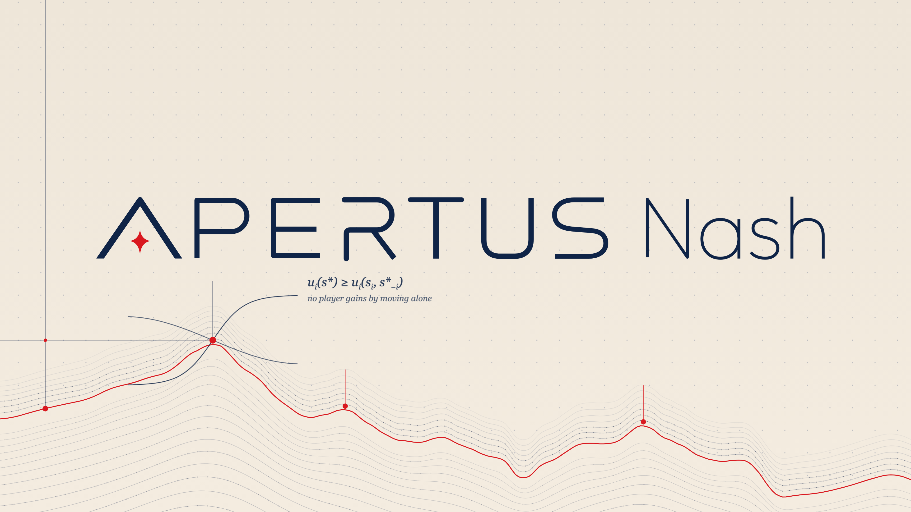

# Apertus Nash

[](assets/apertus_nash.mp4)

*▶ [Watch the 48-second introduction](assets/apertus_nash.mp4) (with sound).*

> [!NOTE]
> **A note from the author.** This is an experiment, not a finished model. Apertus Nash was trained on a single DGX Spark
> (128 GB of memory) over a few days. That was enough for the supervised fine-tuning, but the reinforcement-learning stage needs
> more time to work well and to generalise beyond its training problems. With more compute, and more data that covers more
> domains and restores basic general instruction-following, I believe the model can do noticeably better.

LoRA fine-tuning of [Apertus-v1.5-8B](https://huggingface.co/swiss-ai/Apertus-v1.5-8B) into **Apertus Nash**, an assistant for
mathematics, statistics and economics that reasons in plain prose and answers in readable language. Two parts:

- **SFT** in three stages: a broad reasoning mix, then a small economics and mathematics set with code-verified references.
- **RLAIF** (reinforcement learning from AI feedback) with GRPO: an AI judge in a separate reward service scores every answer,
  grounded in a verified reference and in facts the service measures exactly.

Everything runs on one NVIDIA DGX Spark (GB10, 128 GB unified memory) with Docker.

## Pipeline

| Stage | Config | Data | Starts from | Length |
|---|---|---|---|---|
| 1. SFT, broad mix | `1_sft_mix3d_stage1.yaml` | mix3d stage 1 (86,630 rows) | base model | 845 steps |
| 2. SFT, broad mix | `2_sft_mix3d_stage2.yaml` | mix3d stage 2 (73,328 rows) | stage 1 | 3,214 steps |
| 3. SFT, Nash set | `3_sft_nash.yaml` | `data/nash/sft.jsonl` (1,200 rows) | stage 2 | 3 epochs |
| 4. RLAIF | `4_rl_v3.yaml` | `data/nash/rlaif.jsonl` (1,036 problems) | stage 3, best | 150 updates |
| 5. RLAIF | `5_rl_v4.yaml` | same | stage 4 | 518 updates (4 epochs) |

The released model is the stage-5 adapter at step 517. All stages use LoRA rank 64 / alpha 128, bf16 and at most 4,096 tokens per
sequence. RL uses Dr. GRPO with 8 prompts × 8 samples per update, learning rate 1e-5 and vLLM rollouts.

The released model's stage 1 started from an adapter of earlier exploratory runs, which are not included: running the configs from the
base model reproduces the recipe, not the exact weights.

## Results

**RL, stage 5**, accuracy on the training problems per epoch: 0.15 → 0.15 → 0.18 → **0.25**. On the same prompts, intermediate problems
went from 0.20 to 0.39 and advanced ones from 0.05 to 0.16. None of the challenging problems was ever solved. These are training-set
numbers; there is no proper held-out evaluation yet.

**Side by side** with the base model, same settings (single conversations, not a benchmark):

| Conversation | Base: thinking / total tokens | Nash: thinking / total tokens |
|---|---|---|
| [Learning algebra (English)](assets/examples/base_vs_nash_algebra_en.pdf) | 1,152 / 2,194 | 55 / 683 |
| [Redistribution and welfare (French)](assets/examples/base_vs_nash_welfare_economics_fr.pdf) | 1,748 / 3,867 | 930 / 1,784 |

Nash is far more concise, and thinks longer only on the hard request (creating an exercise: 547 thinking tokens against 242). It
answered three of the four French turns in English, a weakness to fix.

## Data

| Folder | Rows | What |
|---|---|---|
| `data/nash/` | 1,250 SFT rows, 1,046 RL problems | our set: economics, game theory, statistics and mathematics, mostly English and French. Every reference is checked by a Python program (`verification.jsonl`); all 1,250 pass. RL problems have exact structured answers, graded field by field with SymPy. |
| `data/synthetic/` | 1,149 | our synthetic reasoning set, each row written individually by an AI model: 1,089 problems with a flawed draft that the reasoning finds and repairs, 50 olympiad problems, 10 design briefs |
| `data/eval/traps.jsonl` | 86 | well-known trick prompts ("strawberry", the car wash, Moses' ark…) with grading keys; evaluation only, never trained on |
| `data/mix3d/` | 87,396 | the broad SFT mix (science, chat, math, instruction following, code; 26% non-English), as a manifest |

The third-party rows of mix3d are not redistributed. `python scripts/build_mix3d.py` rebuilds both stage files from their sources
and checks every row against a content hash; the project's own rows come from `data/nash` and `data/synthetic`.

| mix3d source | Rows | Licence |
|---|---|---|
| [CohereLabs/tiny-aya-l2-thinker-multilingual-reasoning](https://huggingface.co/datasets/CohereLabs/tiny-aya-l2-thinker-multilingual-reasoning) | 51,961 | **CC-BY-NC-4.0, non-commercial** |
| [nvidia/Nemotron-Cascade-2-SFT-Data](https://huggingface.co/datasets/nvidia/Nemotron-Cascade-2-SFT-Data) | 22,040 | see dataset card |
| [nvidia/Nemotron-SFT-Instruction-Following-Chat-v3](https://huggingface.co/datasets/nvidia/Nemotron-SFT-Instruction-Following-Chat-v3) | 6,477 | see dataset card |
| [nvidia/Nemotron-SFT-Competitive-Programming-v2](https://huggingface.co/datasets/nvidia/Nemotron-SFT-Competitive-Programming-v2) | 4,905 | see dataset card |
| [nvidia/Nemotron-SFT-Math-v3](https://huggingface.co/datasets/nvidia/Nemotron-SFT-Math-v3) | 905 | see dataset card |
| Project rows | 910 | this repo |
| Small third-party sets, not rebuilt | 198 | left out (0.2%) |

## Reward

For each group of 8 answers, the reward service measures exact facts (a field-by-field check against the verified reference, repetition
in the thinking, reply defects). A DeepSeek judge must trust these facts, never replaces the reference with its own solution, and scores
all 8 answers in one call. Full rules: `reward_service/reward_prompt.md`.

| The judge decides | Rule |
|---|---|
| **Correct** | matches the reference in every value (equivalent exact forms are fine, a rounded decimal is not) |
| **T**, thinking quality (0–1) | 1 if every step is valid; a false step that stands costs at least 0.3; thinking about another problem gets 0 |
| **Format** | the result is stated in readable sentences, in the problem's language; a bare JSON object fails |
| **Bonus** (0–0.5) | only for the best few clean, correct answers in the group |

| Outcome | Reward |
|---|---|
| Correct | `0.75 + 0.25 × format − (1 − T) + bonus` (best: 1.5) |
| Wrong | `−1 − (1 − T)` |
| Cut off, looping while wrong, or addressing the grader | `−2` |
| Looping while correct | at most `0` |
| Stray thinking marker or answer given twice | format = no, `−0.3` |

## Architecture

```
┌──────────────────────── trainer container (GPU) ─────────────────────────┐
│  vLLM rollouts ──► 8 answers per problem ──► POST /reward ──┐            │
│       ▲                                                      │            │
│  merged LoRA weights                  rewards ◄──────────────┘            │
│       │                                   │                               │
│  policy (Apertus 8B + LoRA) ◄── GRPO update (advantages, backward pass)   │
└───────────────────────────────────────────┬───────────────────────────────┘
                                            │ HTTP, internal network only
┌──────────────────── reward service container (CPU) ──────────────────────┐
│  exact facts (grader, repetition, reply defects) ──► DeepSeek judge       │
│  reward.py · reward_prompt.md · reward_config.json   (re-read live)       │
└───────────────────────────────────────────────────────────────────────────┘
```

**The reward is a separate service**, so it can change while training runs, in response to what the model does. RL exploits whatever
the reward fails to punish, and that only shows up mid-run. The service re-reads its rubric and code on every request: a fix lands at the
next update, with no restart and no lost optimiser state. Every reward carries a version hash; a broken edit keeps the last good version;
a group the judge cannot score is dropped, never guessed. Only the service holds the API key.

Both changes below happened inside a single trainer process that was never restarted:

| Run | Change, and why | Effect |
|---|---|---|
| Stage 4, from about update 78 | the model drifted into loops: cut-off answers now get −2, repetition is penalised | truncated answers 44.7% → 4.4% |
| Stage 5, from update 31 | the judge stops writing code; the service computes the facts | cost per update $0.074 → $0.022 |

Other choices: one LoRA shape for every stage, so each adapter starts the next; vLLM inside the trainer with a log-prob parity check
against drift; groups whose 8 rewards are all equal are skipped; the exact grader runs in its own process with a timeout; a memory
watchdog for the DGX Spark's unified memory.

## Usage

Needs an NVIDIA DGX Spark (ARM64) or similar, Docker with the NVIDIA runtime, `secrets/hf_token` and, for RL, `secrets/deepseek_key`.

```bash
./rlaif doctor && ./rlaif build && ./rlaif test
python scripts/build_mix3d.py

./rlaif sft --config configs/1_sft_mix3d_stage1.yaml                 # stop after step 845 with ./rlaif stop
./rlaif sft --config configs/2_sft_mix3d_stage2.yaml --init-adapter /runs/nash-sft-mix3d-stage1/checkpoints/step-000845/adapter
./rlaif sft --config configs/3_sft_nash.yaml --init-adapter /runs/nash-sft-mix3d-stage2/checkpoints/step-003214/adapter
./rlaif rl  --config configs/4_rl_v3.yaml --init-adapter /runs/nash-sft/best/adapter
./rlaif rl  --config configs/5_rl_v4.yaml --init-adapter /runs/nash-rl-v3/checkpoints/step-000149/adapter

python scripts/merge_adapter.py runs/nash-rl-v4/checkpoints/step-000517/adapter apertus-nash    # standalone merged model
```

Runs resume from their last checkpoint when relaunched; outputs go to `runs/<run_name>/`.

## Layout

```
configs/          one config per stage
data/             nash/, synthetic/, eval/, mix3d/ (see Data)
src/rlaif/        trainer: sft.py (SFT), train.py (GRPO), policy.py, rollout.py (vLLM), structured.py (answer format)
reward_service/   reward service: server.py, reward.py, reward_prompt.md (rubric), grade_answers.py (exact grader)
scripts/          build_mix3d.py, merge_adapter.py
assets/           introduction video, cover image, side-by-side example PDFs
tests/            unit tests (./rlaif test)
```
